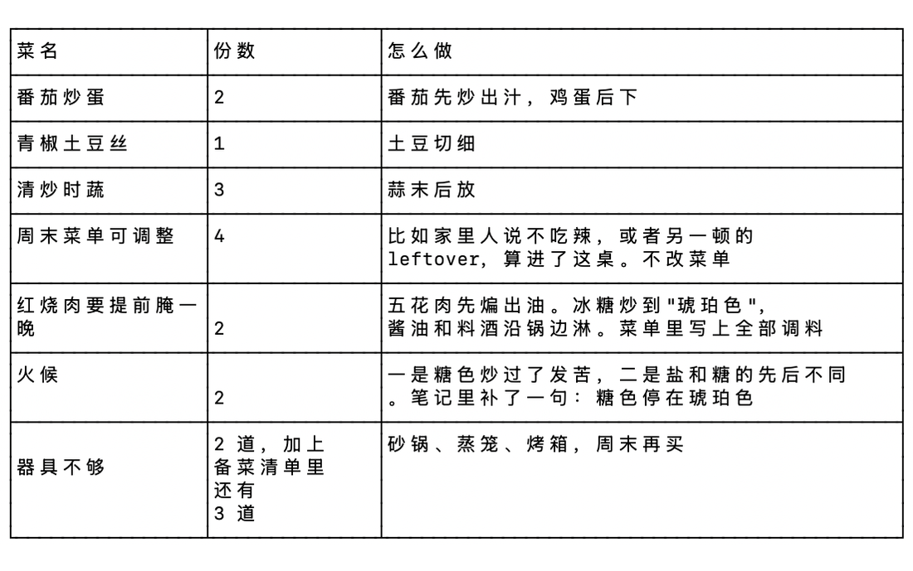
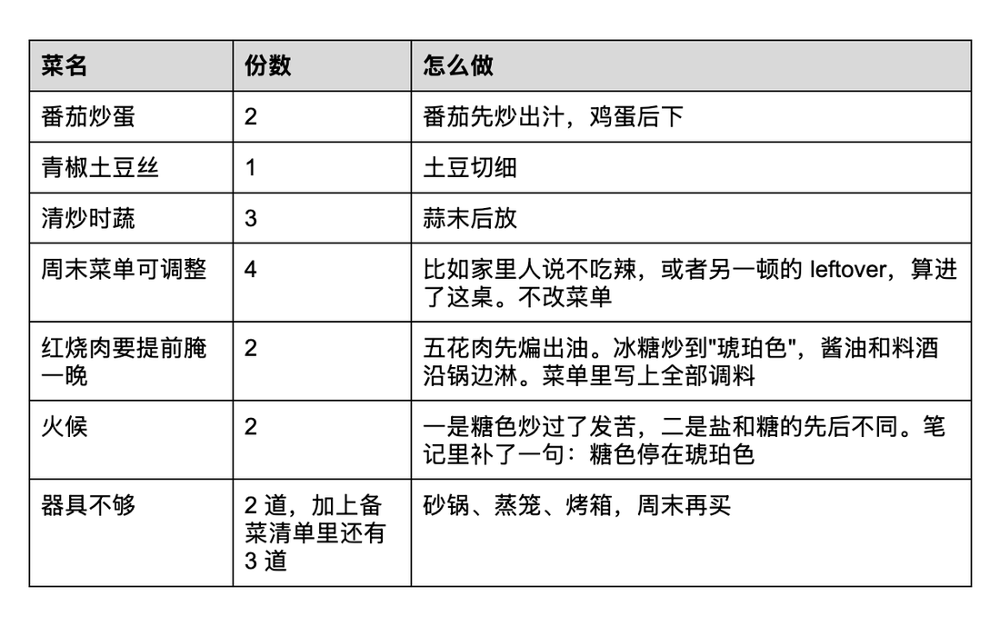
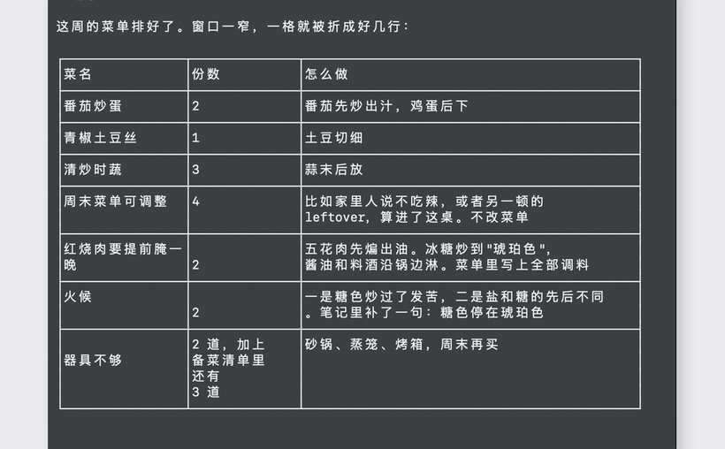

# table2docs

> 解决终端方框表（Unicode / Markdown / ASCII）直接 ⌘V 贴进 Google Docs 变乱码、断行错乱的 macOS 小工具。

在终端或 AI CLI 工具里复制了一张表，直接 ⌘V 粘贴到 Google Docs / Word，得到的依然是 `┌─┬─┐` 字符画，而且由于终端窗口太窄折出来的换行全被硬编码了，格式惨不忍睹。

**table2docs** 的作用就是：你把终端里的表复制好，在终端敲一下 `table2docs`，再去 Google Docs 按 ⌘V，粘贴出来的就是**文档原生的漂亮表格**，中文连贯、英文空格保留、硬折行自动拼回。

---

## 🎯 痛点展示

**直接粘贴（⌘V）：**
终端里的表因为窗口窄变成了这样：



```text
│周末菜单可调整  │4             │比如家里人说不吃辣，或者另一顿的            │
│                │              │leftover，算进了这桌。不改菜单              │
```

直接贴进 Google Docs，断行还在，窗口一变断行位置全错，甚至保留了字符画边框。

**用 table2docs 处理后（⌘V）：**



这是工具生成的表格。Google Docs 粘贴时读的就是这种 HTML。



在 Google Docs 里自动渲染成原生 table，并且文本自动清理：

> 「比如家里人说不吃辣，或者另一顿的 leftover，算进了这桌。不改菜单」
> *(中文与中文紧密接上，中英文之间保留正常空格，去除对齐用的多余空格和垂直居中空行)*

---

## 🚀 快速上手

适用于 macOS。使用系统自带 Python 3，**无需安装任何依赖，无需登录 Google**。

```bash
git clone git@github.com:zhan9yx/table2docs.git
cd table2docs
pip install .
```

*(脚本会装进当前 Python 的可执行目录，这个目录要在 `PATH` 里。不想用 pip 时：)*

```bash
chmod +x src/table2docs/cli.py
ln -sf "$(pwd)/src/table2docs/cli.py" ~/.local/bin/table2docs
```

### 基本用法

1. 在终端或聊天窗口复制整张表格
2. 终端运行：
```bash
table2docs
```
3. 打开 Google Docs，直接 **⌘V** 粘贴即可！

---

## 🔄 常用工作流与命令

`table2docs` 极其灵活，支持剪贴板、文件流以及管道输入：

| 命令 | 说明 |
| --- | --- |
| `table2docs` | 默认读剪贴板，清洗后写回可直接粘贴的表格格式 |
| `table2docs examples/menu.txt` | 从指定文件读取表格 |
| `pbpaste \| table2docs` | 从管道读取 |
| `table2docs --stdout examples/menu.txt` | 仅输出 HTML 到终端，不修改剪贴板 |

> 💡 **小技巧**：处理完后，剪贴板同时写入了 HTML/RTF 和原始文本。按 **⌘V** 贴出富文本表格；如果还想贴回原始框线表，按 **⌘⇧V** (粘贴纯文本) 即可。

---

## 🤖 快捷集成到 AI CLI 聊天工具

在终端 AI 工具里，可以直接输入 `/table` 快速清洗刚复制的回答（如果回复里有多张表，复制哪张就转哪张）。

自动识别并写入支持的工具（如 Claude Code, Cursor, Copilot, Gemini CLI, Grok 等）：

```bash
# 交互式选择安装（使用 ↑↓ 移动，空格勾选，回车确认）
table2docs bootstrap

# 或指定工具一键安装 /table 命令
table2docs install claude grok

# 卸载 /table 命令
table2docs uninstall claude
```

> **注意**：
> * 已经开着的终端窗口需重新打开或 reload 才能生效（如 Pi 输入 `/reload`，Copilot 用 `/skills reload`，Droid 在 `/commands` 里按 R）。
> * 只安装了 `claude` 时，`grok` 也能识别并使用该命令。

---

## 🛠 工作原理

1. **智能识别**：自动识别 Unicode 方框表（`┌─┬─┐`）、Markdown 表格及 `+---+---+` ASCII 表，自动剔除表外的杂乱文本。
2. **文本修复**：去除对齐填充空格，清理垂直居中的空行；智能合并格子内部被硬折断的文本（自动处理中英文排版空格）。
3. **多格式剪贴板写回**：同时往 macOS 剪贴板注入 HTML 和 RTF。Google Docs / Word / PowerPoint 优先读取 HTML 渲染原生表格，Pages 优先读取 RTF。

---

## ⚠️ 限制

* **系统平台**：仅支持 macOS。
* **换行逻辑**：无法完美区分“终端窗口太窄导致的硬折行”与“格子里人为段落换行”，格子内的换行一律会合并成顺畅的一句话。
* **单元格**：暂不支持合并单元格。

---

## 项目结构

```text
src/table2docs/     命令
examples/menu.txt   示例方框表
docs/images/        截图
```

## 📄 License

MIT。正文见 [LICENSE](LICENSE)。
